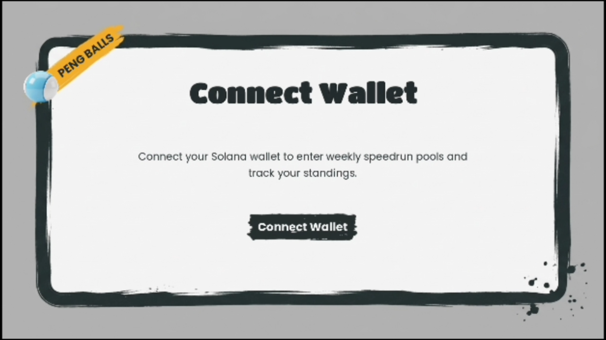
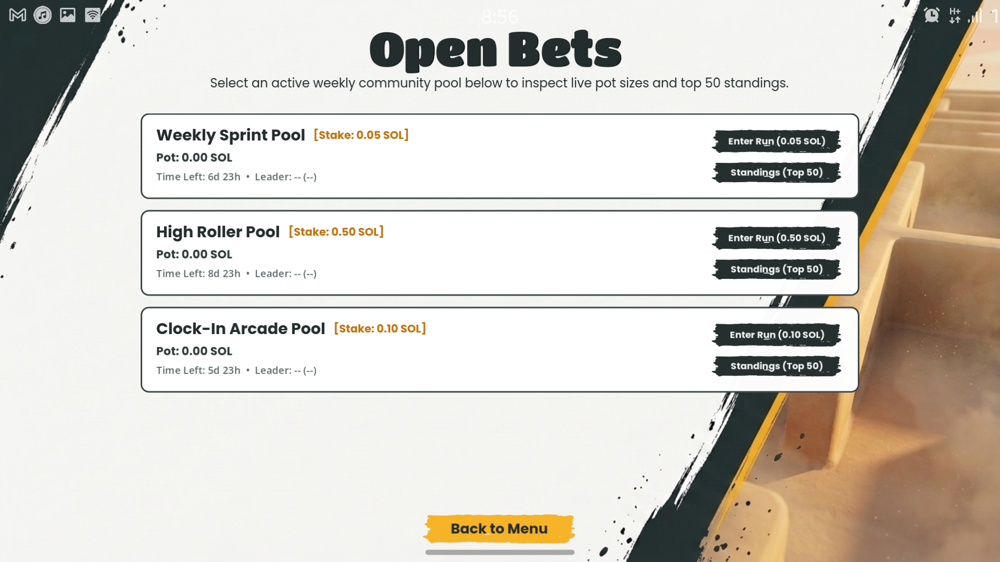
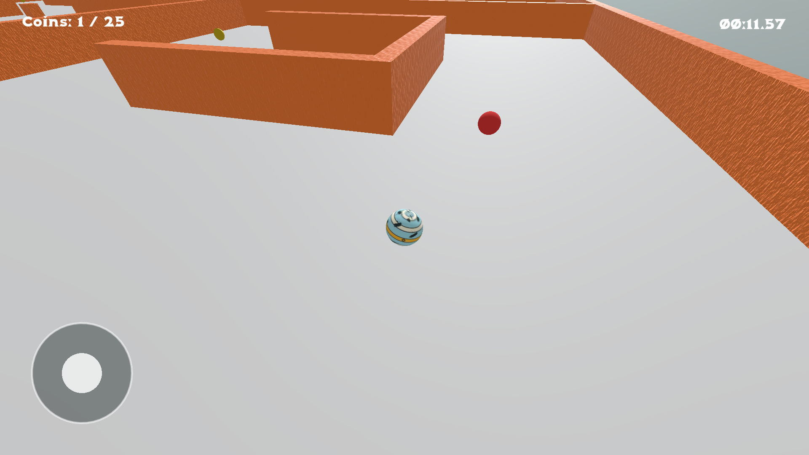

<p align="center">
  
</p>

<h1 align="center">Peng Balls</h1>

<p align="center"><b>Roll fast. Stake your time. Top the weekly board.</b><br/>
A native 3D arcade time trial for Solana Seeker, with weekly prize pools held on-chain.</p>

<p align="center">Built for <b>Clock In</b>, the Solana Mobile hackathon by Radiants.</p>

<p align="center">
  <a href="https://github.com/abrahamebij/peng-balls/releases/latest/download/pengBalls.apk"><b>Download APK</b></a> ·
  <a href="https://youtu.be/qEhcvXdnvpg"><b>Demo video</b></a> ·
  <a href="https://docs.google.com/presentation/d/1X4Nzr9cnJtR536Qe067KJcmHTTK55mwV3nDstssADbE/edit?usp=sharing"><b>Pitch deck</b></a> ·
  <a href="https://github.com/abrahamebij/peng-pool-program"><b>Backend repo</b></a>
</p>

[](https://youtu.be/qEhcvXdnvpg)

<p align="center">
  
  
  
  
</p>

---

## Contents

1. [What it is](#what-it-is)
2. [Try it in 2 minutes](#try-it-in-2-minutes)
3. [How a run works](#how-a-run-works)
4. [Mobile-native by design](#mobile-native-by-design)
5. [Solana integration](#solana-integration)
6. [SKR integration](#skr-integration)
7. [Architecture and transaction model](#architecture-and-transaction-model)
8. [Fair play and anti-cheat](#fair-play-and-anti-cheat)
9. [Run it from source](#run-it-from-source)
10. [Repository map](#repository-map)
11. [Status and known limitations](#status-and-known-limitations)
12. [Roadmap](#roadmap)

---

## What it is

Peng Balls is a mobile arcade game. You roll a penguin ball through a 3D maze, collect all **25 coins**, and dodge wandering enemies. The timer counts up in milliseconds, so every run is a score.

There are two ways to play:

- **Casual mode.** Free practice with no stake.
- **Staked mode.** Enter a weekly prize pool. Each pool is a fixed round (for example 7 days) with its own pot and its own **top 50 leaderboard**. When the round ends, the fastest player claims **90% of the pot** and **10%** goes to the protocol.

Nothing in the result depends on luck. Whoever plays fastest wins.

**Why it works for the Seeker community:** a one-minute run, a weekly reset, a personal best to beat, and a prize that rewards skill. That is a habit loop, not a one-time download.

## Try it in 2 minutes

1. Download the [APK](https://github.com/abrahamebij/peng-balls/releases/latest/download/pengBalls.apk) and install it on an Android phone (Seeker, or any recent Android device).
2. Install a Solana wallet that supports Mobile Wallet Adapter (Phantom, Solflare or Backpack).
3. Open the app and connect your wallet.
4. Choose **Casual** to play right away, or open **Weekly Pools** to see the active round.
5. To try a staked run, get Devnet SOL from the [Solana faucet](https://faucet.solana.com) and enter a pool.
6. Finish a run and watch your time land on the leaderboard.

> The app runs on **Solana Devnet**. Nothing you stake has real value.

**Prefer to watch first?** The [3-minute demo](https://youtu.be/qEhcvXdnvpg) shows the full flow on a real phone: wallet sign-in, entering a pool, playing a run, the leaderboard update and the Devnet transactions.

## How a run works

1. Roll through the maze with the touch joystick (or WASD and arrow keys on desktop).
2. Collect all 25 coins.
3. Avoid the enemies. If one catches you, the run ends in defeat.
4. Collect the last coin to finish. Your time in milliseconds is submitted and ranked.

<p align="center">
  
</p>

## Mobile-native by design

This is not a port and not a web wrapper. It is a Godot 4 game built for a phone from the start.

| Mobile detail | What it does |
|---|---|
| **Native Godot 4 build** | Exported as an Android APK. No WebView, no PWA shell. |
| **Thumb-first controls** | A virtual touch joystick in `TouchControl.gd`, tuned for landscape play. |
| **Landscape layout** | The whole UI is designed for landscape phones. |
| **Mobile Wallet Adapter sign-in** | The player connects through their installed wallet app and approves every transaction there. |
| **Session caching** | The wallet session is stored on the device (`user://wallet_session.json`), so players do not reconnect on every launch. |
| **Live balances** | SOL and SPL token balances are fetched on Devnet and shown in the app. |
| **Short sessions** | A run takes about a minute, so it fits into a commute or a break. |

<p align="center">
  
  
</p>

## Solana integration

| | |
|---|---|
| Network | Solana Devnet |
| Program ID | `2G9MvvQTCjFmNn3Bm98ibJ34cCsW2eXEoieWtsRiRnpf` |
| Assets | Native SOL and SPL tokens, including SKR |
| Wallets | Anything that supports Mobile Wallet Adapter |
| Client SDK | Godot Solana SDK, wired up in `scripts/global_state.gd` |
| Pool data | REST API client in `scripts/pool_data_service.gd` |

The on-chain program, escrow design and API are documented in the [backend repo](https://github.com/abrahamebij/peng-pool-program).

**Devnet proof.** Real transactions from a full round, so you can check them without running anything:

| Step | Devnet transaction |
|---|---|
| Pool created | [View on Solscan](TODO-solscan-link?cluster=devnet) |
| Entry stake deposited | [View on Solscan](TODO-solscan-link?cluster=devnet) |
| Run result recorded | [View on Solscan](TODO-solscan-link?cluster=devnet) |
| Prize claimed | [View on Solscan](TODO-solscan-link?cluster=devnet) |

## SKR integration

Pools can be funded and entered with **SKR** as an SPL token alongside native SOL. The program has separate instruction paths for SOL and for SPL tokens, so a pool is created for one asset and every entry and payout in that pool uses the same asset. This lets the Seeker community compete with the token they already hold.

## Architecture and transaction model

```
 Godot 4 mobile game (this repo)
        |
        |--- Mobile Wallet Adapter ---> Player wallet (Seeker / Phantom / Solflare / Backpack)
        |                                        |
        |                                        v  approves the entry stake
        |--- HTTPS ---> API server (peng-pool-program/server, Vercel)
        |                       |
        v                       v
   Solana Devnet: peng_pool Anchor program
        |-- PDA escrow vault (the pot)
        |-- Round state (best time, leader)
        '-- Top 50 leaderboard, 90/10 payout at round end
```

**Life of a round**

1. **Pool creation.** A round is initialized with an entry fee, a duration, an escrow vault (a PDA) and an empty top 50 leaderboard.
2. **Entry.** The player approves a transaction in their wallet. The stake moves into the escrow vault and the player receives an active run ticket.
3. **Run.** The game is played locally. When the run finishes, the time in milliseconds is validated by the API and recorded through the program.
4. **Leaderboard write.** The recorded result updates the player's personal best, win and loss stats, and the on-chain top 50.
5. **Round close.** Once the on-chain clock passes the round end time, the round can be claimed.
6. **Payout.** The program pays **90% of the pot** to the fastest player and **10%** as the protocol fee.

Full instruction and account details are in the [backend README](https://github.com/abrahamebij/peng-pool-program#readme).

## Fair play and anti-cheat

Short version: the money is protected by the program, and run times are checked by the API before they count. This is a hackathon build on Devnet, so the limits are listed openly below.

**What protects the pool today**

- The pot sits in a **program-owned escrow vault**. No personal wallet holds it.
- A player must **enter and stake** before a run ticket exists.
- Prizes can only be claimed **after the round end time**, enforced by the on-chain clock.
- Run results are submitted to the API, which **validates them before they are recorded**. TODO: replace this line with the exact checks (for example time bounds, ticket ownership, one result per ticket).

**Known limits**

- The timer runs inside the game client, so a modified client is the main risk for any client-timed game.
- Stronger protections are on the roadmap: signed run payloads, server-side plausibility checks against maze data, and replay verification of recorded inputs.

## Run it from source

**Requirements:** Godot 4.x (the project is configured for 4.7), Android export templates, the Godot Solana SDK addon, a real Android device or an emulator with a wallet app installed.

```bash
git clone https://github.com/abrahamebij/peng-balls
```

1. Open `project.godot` in Godot.
2. Confirm the Solana SDK addon is enabled under **Project > Project Settings > Plugins**. TODO: say whether the addon is committed to the repo or installed from the Asset Library.
3. Check the API base URL in `scripts/pool_data_service.gd`. It points to `https://peng-pool-program.vercel.app/api` by default.
4. Export to Android (**Project > Export > Android**) and install on a device.

No secrets are stored in this repository.

## Repository map

```
peng-balls/
  scenes/
    game/        Game loop (Game.gd), Player.gd, Coin.gd, Enemy.gd, TouchControl.gd
    level/       Maze level (Level.gd)
    menu/        Main menu (Menu.gd)
  scripts/
    global_state.gd        Wallet connection, session cache, balances
    pool_data_service.gd   API client: pools, standings, entries, run results
  project.godot            Godot 4 project, mobile landscape config
```

## Status and known limitations

| | |
|---|---|
| Playable Android APK | Yes |
| Wallet connect through Mobile Wallet Adapter | Yes |
| Weekly pools, entries and leaderboard on Devnet | Yes |
| SOL and SPL (SKR) pool support in the program | Yes |
| Prize claim at round end | Implemented in the program. TODO: confirm tested end to end on Devnet. |
| Mainnet | Not yet |
| Solana dApp Store listing | Planned within 30 days of the results |

**Known limitations**

- Devnet only. Pool sizes and payouts are test values.
- Client-timed runs, as described in [Fair play](#fair-play-and-anti-cheat).
- One maze layout today.

## Roadmap

1. Publish a signed release build on the Solana dApp Store.
2. Harden run verification (signed payloads and replay checks).
3. Move pools to mainnet after review.
4. New mazes and weekly themes so every round feels different.

## Links

- **Demo video:** https://youtu.be/qEhcvXdnvpg
- **Pitch deck:** https://docs.google.com/presentation/d/1X4Nzr9cnJtR536Qe067KJcmHTTK55mwV3nDstssADbE/edit?usp=sharing
- **APK:** https://github.com/abrahamebij/peng-balls/releases/latest/download/pengBalls.apk
- **Backend and program:** https://github.com/abrahamebij/peng-pool-program

## Author

**Abraham Ebijuni** ([@abrahamebij](https://github.com/abrahamebij)), solo builder.

## License
Apache-2.0 license
